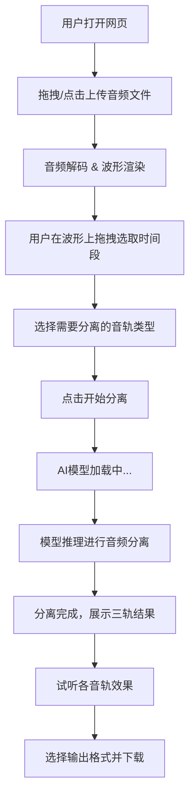

## 1. 产品概述

AI音频智能分离平台 —— 一款纯浏览器端运行的音频源分离工具。用户上传任意音乐文件后，可选择指定的时间段，通过浏览器端AI模型将音频智能分离为**人声**、**配乐**、**音效**三个独立音轨，支持WAV/MP3格式下载导出。

- **目标用户**：音乐制作人、视频创作者、播客制作者、Remix爱好者
- **核心价值**：无需安装任何软件、无需后端服务器，打开网页即可完成专业级音频分离

## 2. 核心功能

### 2.1 功能模块

1. **音频上传模块**：拖拽/点击上传，支持主流音频格式（MP3、WAV、FLAC、OGG、M4A）
2. **波形可视化模块**：上传后自动生成高精度音频波形图，支持缩放与拖拽
3. **时间段选择模块**：在波形图上拖拽选取需要分离的时间区间，支持多段选取
4. **AI分离引擎**：浏览器端运行轻量化Demucs/Open-Unmix模型，分离为三轨（人声、配乐、音效）
5. **音轨预览模块**：分离完成后可分别试听各音轨，支持独奏/静音切换
6. **导出下载模块**：选择WAV或MP3格式，单独或批量下载分离后的音轨

### 2.2 页面详情

| 页面名称 | 模块名称 | 功能描述 |
|---------|---------|---------|
| 主工作台 | 上传区域 | 大面积拖拽上传区，支持点击选择文件，显示格式/大小限制提示 |
| 主工作台 | 波形展示区 | 全宽波形图渲染，鼠标滚轮缩放，拖拽平移，支持精度调节 |
| 主工作台 | 时间选区控制 | 拖拽手柄设置起止时间，显示精确时间码，支持多段选区 |
| 主工作台 | 分离控制面板 | 选择分离轨道（人声/配乐/音效），一键启动分离，实时进度显示 |
| 主工作台 | 音轨预览面板 | 分离结果以卡片形式展示，每轨含波形缩略图、播放/暂停、独奏、音量调节 |
| 主工作台 | 导出面板 | 格式选择（WAV/MP3），单轨下载或一键打包下载全部音轨 |

## 3. 核心流程

## 4. 用户界面设计

### 4.1 设计风格

- **整体调性**：暗色音乐工作室风格，营造专业音频工作台氛围
- **主色调**：深色背景（#0a0a0f），搭配电光蓝（#4f8fff）作为主强调色，辅以品红（#e04090）点缀
- **字体**：标题使用 Geist 或 DM Sans（现代几何无衬线），等宽字体用于时间码显示
- **按钮风格**：圆角半透明毛玻璃按钮，悬停时发光效果
- **布局**：全屏单页工作台，自上而下流式布局，各模块间用细线分隔
- **动效**：波形加载有流光扫描动画，分离过程有脉冲呼吸动效，卡片悬停有微浮起效果

### 4.2 页面设计概览

| 页面名称 | 模块名称 | UI元素 |
|---------|---------|--------|
| 主工作台 | 顶部导航栏 | Logo + 标题「AudioSift」，右侧简洁设置图标 |
| 主工作台 | 上传区域 | 虚线边框大区域（未上传时占据主要视觉空间），内含上传图标+提示文字，拖入文件时边框高亮发光 |
| 主工作台 | 波形展示区 | 深色背景上的高亮波形图，已选区域高亮着色（人声=蓝、配乐=紫、音效=橙），时间轴刻度标尺 |
| 主工作台 | 分离控制面板 | 三个轨道开关（带颜色标识的开关按钮），「开始分离」主按钮带渐变发光，进度条+百分比文字 |
| 主工作台 | 音轨预览面板 | 三列卡片布局，每张卡片含：轨道名称、颜色标识条、迷你波形、播放按钮组（播放/暂停/独奏）、音量滑块、下载按钮 |
| 主工作台 | 导出面板 | 格式切换Radio按钮组，单轨下载链接 +「打包下载全部」按钮 |

### 4.3 响应式设计

- 桌面端优先设计（1280px+），充分利用宽屏空间
- 平板端（768px-1280px）：音轨预览卡片由三列变为单列堆叠
- 移动端（<768px）：简化波形交互（仅支持基础拖拽），按钮增大以适配触屏

## 5. 非功能需求

- **性能**：音频文件限制 ≤ 100MB，AI模型首次加载 ≤ 15秒（模型会被浏览器缓存）
- **兼容性**：支持 Chrome 95+、Edge 95+、Firefox 100+（需支持WebAssembly和WebGPU/WebGL）
- **隐私**：所有音频处理完全在浏览器本地执行，不上传任何数据到服务器
- **国际化**：界面语言为简体中文
