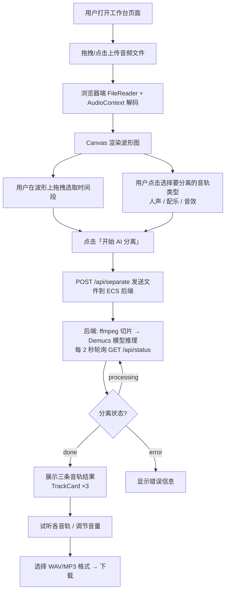
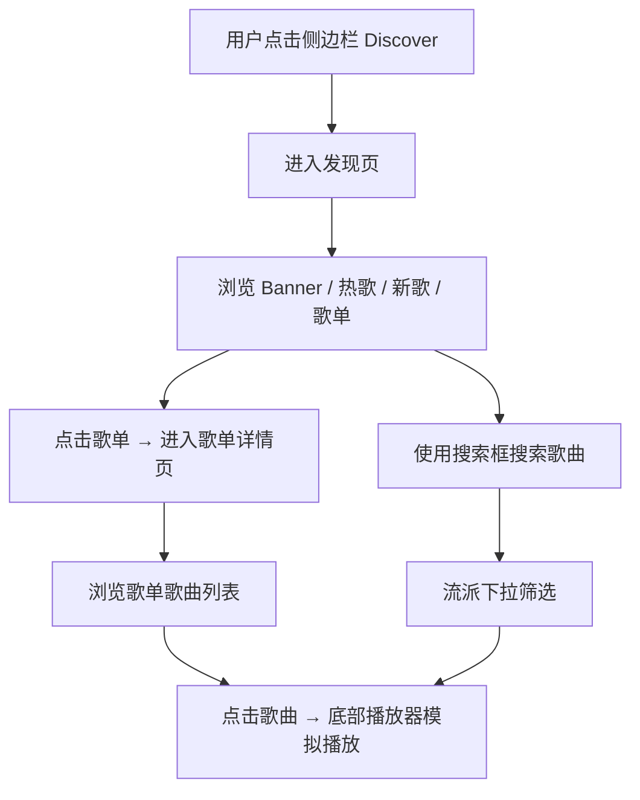

## 1. 产品概述

AudioSift 是一款 AI 驱动的音频智能分离平台。用户上传任意音乐文件后，可选择指定的时间段和需要分离的音轨类型，通过部署在阿里云 ECS 上的 **Meta Demucs 深度学习模型** 将音频智能分离为 **人声**、**配乐**、**音效** 三条独立音轨，支持 WAV/MP3 格式下载导出。同时内建 **音乐发现** 功能，提供歌单浏览、热门歌曲排行和模拟播放体验。

- **目标用户**：音乐制作人、视频创作者、播客制作者、Remix 爱好者、音乐发烧友
- **核心价值**：无需安装任何软件，打开浏览器即可完成专业级 AI 音频分离；同时提供丰富的音乐浏览发现体验

## 2. 核心功能

### 2.1 功能模块总览

#### 音频分离工作流（Workbench 页面 — `/`）

1. **音频上传模块**：拖拽/点击上传，支持 MP3、WAV、FLAC、OGG、M4A、AAC 格式，最大 100MB。上传后自动解码并展示音频信息（文件名、大小、声道数、采样率、时长）
2. **波形可视化模块**：上传后自动渲染高精度 Canvas 音频波形图。支持鼠标滚轮缩放（1x ~ 50x），拖拽选取时间区间，已选区域以蓝色半透明矩形 + 竖线 + 手柄标记显示，选区列表含精确时间码和删除按钮
3. **AI 分离控制面板**：三个音轨类型按钮组（人声/蓝色、配乐/紫色、音效/橙色），选中态有对应颜色填充和辉光。一键启动分离，实时进度条 + 百分比。分离过程中可随时停止
4. **音轨预览模块**：分离完成后以三张独立卡片展示，每张含彩色标识条、音轨名、时长、播放/暂停按钮、音量滑块（0-1）、下载按钮。支持 Solo 独奏模式
5. **导出下载模块**：格式切换（WAV 无损 / MP3 320kbps 压缩），打包下载全部音轨或单轨独立下载

#### 音乐发现（Discover 页面 — `/discover`）

1. **Banner 横幅区**：3 个渐变色推广卡片（粉红/蓝色/紫色），带 Sparkles 装饰图标，hover 时微缩放效果
2. **Trending Now 热歌区**：横向可滚动卡片列表，支持左右箭头按钮导航。每张卡片 180px 宽，含专辑封面（hover 放大 + 播放图标叠加层）、歌名、艺人名。点击可触发模拟播放
3. **New Releases 新歌区**：纵向列表布局，按发行时间降序排列最新歌曲。每行含序号、小封面、歌名/艺人/专辑、时长
4. **Featured Playlists 精选歌单区**：6 列响应式 Grid 布局，每张卡片含封面（hover 时 ListMusic 图标蒙层淡入）、歌单名、描述标签。点击跳转到歌单详情页
5. **Browse All 全部浏览区**：搜索框（支持歌名/艺人/专辑模糊搜索）+ 流派下拉筛选器 + 可滚动歌曲列表（max-height 400px）。每行含封面、歌名/艺人/专辑、流派标签、时长。空状态提示 "No matching songs found"
6. **底部播放器**：固定底部，封面 + 歌名/艺人 + 播放/暂停 + SkipBack/SkipForward + 进度条。使用 Vue `<Teleport to="body">` + `<Transition name="player-slide">` 实现滑入滑出动画

#### 歌单详情（Playlist 页面 — `/discover/playlist/:id`）

1. **头部信息区**：返回 Discover 按钮 + 200×200 封面大图 + 歌单名（4xl 粗体）+ 描述 + 歌曲数 + 流派标签
2. **歌曲列表**：与 Discover 相同的行式布局，点击触发模拟播放
3. **底部播放器**：与 Discover 共用相同的播放器 UI 和动画
4. **空状态**：歌单未找到时显示 Music 图标 + "Playlist not found" + 返回 Discover 链接

#### 品牌展示（About 页面 — `/about`）

1. **多层 Canvas 背景**：底层专辑封面大图（4 秒循环淡入淡出）、中层 60 个漂浮粒子系统、顶层鼠标手电筒效果（destination-out 合成模式擦除）
2. **内容层**：大标题 "AudioSift"（"Sift" 为品牌粉色 `#e04090`）、副标题、技术标签毛玻璃药丸（Demucs / FastAPI / Vue 3 / Tailwind）
3. **鼠标视差**：背景图随鼠标微移、内容文字反向微移
4. **功能卡片 ×3**：Vocal Extraction / Instrumental Split / Drum Separation，各自以不同速度随页面滚动做视差位移
5. **底部版权**："Move your mouse to reveal · Powered by Demucs · Deployed on Alibaba Cloud"

### 2.2 页面详情

| 页面名称 | 模块名称 | 功能描述 |
|---------|---------|---------|
| 主工作台 | 上传区域 (UploadZone) | 大面积拖拽上传区，点击选择文件。支持拖拽高亮反馈（蓝色辉光 + 阴影 + 图标放大）。显示格式/大小限制。解码中显示旋转 spinner。错误时红色背景 + 错误信息 |
| 主工作台 | 波形展示区 (WaveformViewer) | 全宽 Canvas 波形图，蓝色半透明柱状条（alpha 随峰值 0.15-0.85 变化）。中央水平基线。缩放 ≥1x 显示时间刻度。已选区间蓝色矩形标记 + 拖拽手柄。拖拽中粉色虚线矩形 |
| 主工作台 | 分离控制面板 (SeparationPanel) | 三个轨道开关（人声/蓝色、配乐/紫色、音效/橙色），选中态彩色填充 + 辉光。渐变色圆形开始按钮。处理中文案动态切换。方形停止按钮。渐变色进度条 |
| 主工作台 | 音轨预览面板 (TrackCard) | 三列网格卡片。彩色圆点 + 中文标签 + 时长 + 装饰条纹背景。播放/暂停按钮（粉色暂停态）。音量 Range 滑块。音频元素自动清理 |
| 主工作台 | 导出面板 (ExportPanel) | WAV/MP3 格式切换按钮组。渐变色「打包下载全部」按钮。各音轨独立下载按钮 |
| 音乐发现 | Banner 横幅区 | 3 列渐变卡片（pink/blue/purple），Sparkles 图标 hover 从 20% → 40% 透明度。transition-all duration-500 |
| 音乐发现 | 热歌区 | 横向 scroll-snap 列表，scrollbar-hide。卡片 group hover：封面 scale-110 + 播放按钮 0→100% 淡入。backdrop-blur-sm |
| 音乐发现 | 新歌区 | 纵向列表，序号 + 11px 封面 + 两行文字 + 时长。行 hover 背景变亮 + 边框出现 |
| 音乐发现 | 精选歌单区 | 6 列 Grid（sm:3 md:4 lg:6）。卡片 backdrop-blur-sm。封面 hover scale + ListMusic 图标蒙层淡入。点击跳转路由 |
| 音乐发现 | 全部浏览区 | 搜索 input + 流派 select（均为 backdrop-blur-sm）。max-h-[400px] 滚动歌曲列表。每行含流派标签 pill。空状态搜索图标 + 提示文字 |
| 音乐发现 | 底部播放器 | fixed bottom，ml-[240px] 避让侧边栏。bg-black/70 backdrop-blur-2xl。进度条背景白色 8% + 填充白色 60%（transition-all duration-1000）。player-slide Transition 动画 |
| 歌单详情 | 头部区 | 返回按钮 → Discover，大封面 + 歌单信息 |
| 歌单详情 | 歌曲列表 | 同 Discover 行式布局，底部播放器 |
| 品牌展示 | 多层 Canvas | z-0 背景图（4s 轮换 + 鼠标视差 2%），z-10 粒子（60 个漂浮），z-20 鼠标擦除遮罩（8 个拖尾点），z-30 内容 |
| 品牌展示 | 功能卡片 | Vocal（视差 0.08x）/ Instrumental（0.05x）/ Drum（0.1x），滚动驱动独立位移 |

## 3. 核心流程

### 3.1 音频分离流程



### 3.2 音乐发现流程



## 4. 用户界面设计

### 4.1 设计风格

- **整体调性**：暗色音乐工作室风格，营造专业音频工作台 + 沉浸式音乐发现体验
- **主色调**：深色背景（#08080c / #0a0a0f），搭配品牌色：
  - 蓝色 `#4f8fff`（人声 / 主强调色）
  - 紫色 `#b464ff`（配乐）
  - 橙色 `#ff8c3c`（音效）
  - 粉色 `#e04090`（品牌标识 / Logo / 滑块手柄）
- **字体**：系统默认字体栈，等宽 `tabular-nums` 用于时间码
- **按钮风格**：圆角半透明毛玻璃（backdrop-blur），hover 时边框和背景变亮
- **布局**：
  - 左侧 240px 固定侧边栏（`AppSidebar`, z-40, backdrop-blur-xl, bg-black/40）
  - 主内容区 `ml-[240px]` 流式布局，最大宽度 1000px（工作台）或全宽（发现页）
- **动效**：shimmer 扫描光效（2s 无限循环）、fade-in-up 淡入上浮（0.6s ease-out）、player-slide 滑入滑出（0.3s ease）、卡片 hover 微缩放（scale-110 / scale-102）
- **全局背景**：AlbumWall 9×7 专辑封面无限滚动 + backdrop-blur-[6px] 毛玻璃（About 页面除外）

### 4.2 导航结构

```
AppSidebar (固定左侧，240px)
├── Logo 区域（Music 图标渐变 + "AudioSift"）
├── Workbench（Sparkles 图标，激活：白色 + 粉色图标）
├── Discover（Compass 图标）
├── About（UserRound 图标）
└── 底部用户区（"Guest" + "Free Plan" + 渐变色头像圈）
```

### 4.3 组件层级示意（z-index）

```
z-0   → AlbumWall 专辑网格背景
z-[1] → AlbumWall backdrop-blur-[6px] 全局毛玻璃遮罩
z-[2] → Discover 页面专属 backdrop-blur-[12px] bg-black/30
z-[3] → Discover 页面内容区
z-10  → 主内容区（router-view）
z-40  → AppSidebar 侧边栏
z-50  → 底部播放器（Teleport to body）
```

### 4.4 响应式设计

- 桌面端优先设计（1280px+），充分利用宽屏空间
- 平板端（768px-1280px）：精选歌单 Grid 减少列数（sm:3 → md:4 → lg:6）
- 移动端（<768px）：侧边栏和波形交互需适配（当前以 PC 端为优先）

## 5. 模拟数据

### 5.1 歌曲库

30 首模拟歌曲，涵盖 9 位虚拟艺人和 8 种音乐流派：

| 艺人 | 流派 | 代表专辑 |
|------|------|----------|
| Lynx | Electronic | Nightfall / Backlight |
| Quantum Cat | Electronic / Classical | Galactic Walk |
| Chen Nian | Pop | Four Seasons |
| Nightfall | Rock | Ruins |
| Ono | Pop | Orange Summer |
| BeatFusion | Hip-Hop | City Beats |
| Soda Green | Folk | City Memories |
| Jasmine | R&B | Midnight Paris |
| Amber Quartet | Jazz | Midnight Jazz |

### 5.2 歌单库

12 个精选歌单：Late Night Electronic / Urban Rhythm / Lazy Afternoon / Jazz Lounge / Paris Midnight R&B / Scream Your Heart Out / City Corners / Galactic Traveler / Lynx Essentials / Four Seasons Suite / Chill Vibes Only / Rise and Shine

### 5.3 专辑封面

30 张本地封面图 `/public/albums/album-1.jpg` ~ `album-30.jpg`，通过 `(index-1) % 30 + 1` 循环映射

## 6. 非功能需求

- **性能**：音频文件限制 ≤ 100MB（前端验证）。AI 模型首次加载需下载预训练权重（约 160MB）。GPU 推理约 10x 实时，CPU 约 0.5x 实时
- **兼容性**：支持 Chrome 95+、Edge 95+、Firefox 100+（需 Web Audio API 和 Canvas 2D）
- **服务端处理**：AI 音频分离在阿里云 ECS 服务端执行，文件上传通过 HTTP multipart/form-data
- **部署方式**：GitHub Actions 自托管 Runner 自动部署，systemd 管理后端进程，Nginx 反向代理
- **国际化**：界面语言为简体中文
- **隐私**：音频文件上传到服务器进行 AI 处理，使用 UUID 标识任务，处理后文件可定期清理
