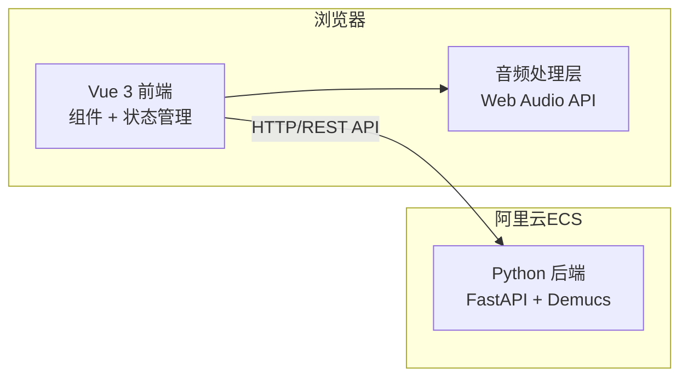
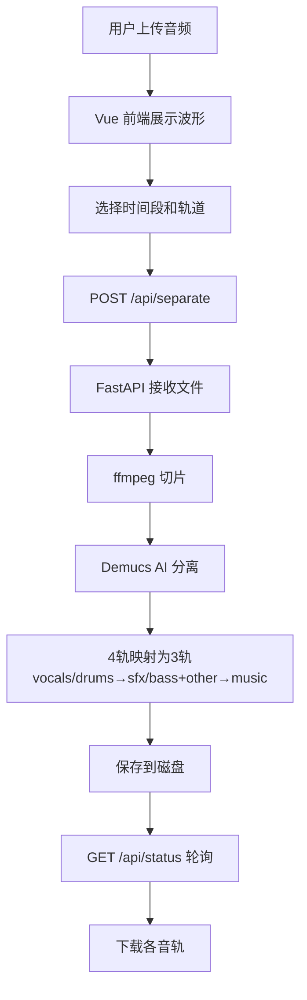
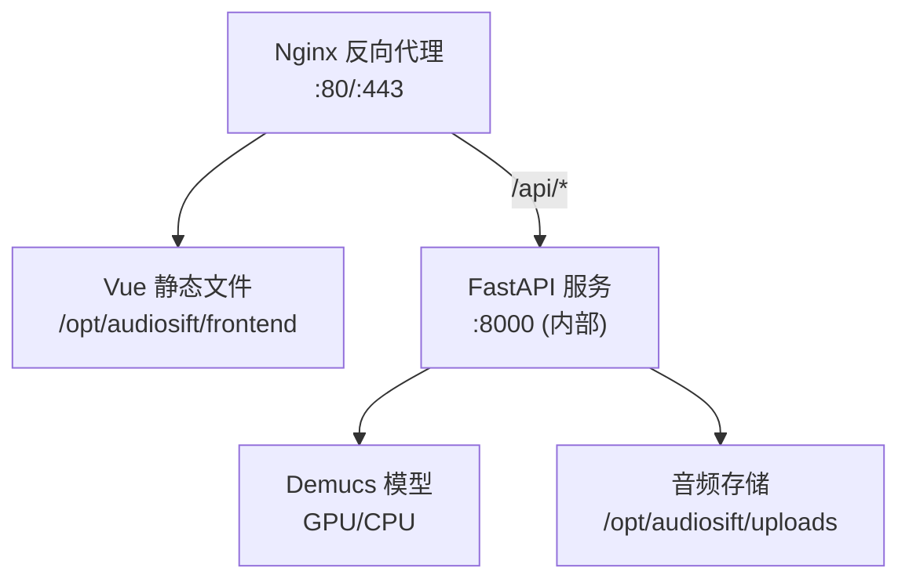

## 1. 架构设计



## 2. 技术选型

| 层级 | 技术 | 说明 |
|-----|------|------|
| 前端框架 | Vue 3 + TypeScript | Composition API，类型安全 |
| 构建工具 | Vite 5 | 极速HMR |
| 样式方案 | TailwindCSS 3 | 原子化CSS |
| 状态管理 | Vue Reactive (composable) | 无需额外依赖 |
| 路由 | Vue Router 4 | SPA路由 |
| 图标 | lucide-vue-next | 高质量图标库 |
| HTTP客户端 | 原生 fetch + FormData | 文件上传 |
| 后端框架 | FastAPI (Python 3.10+) | 异步高性能 |
| AI模型 | Demucs (Meta) | 最先进的音频源分离 |
| 波形渲染 | Canvas API | 高性能波形绘制 |
| 部署 | 阿里云 ECS + Nginx | 反向代理 + 静态资源 |

## 3. 路由定义

| 路由 | 用途 |
|-----|------|
| / | 主工作台（单页应用） |

## 4. 前端组件树

```
App.vue
├── AppHeader.vue (Logo + 标题)
├── UploadZone.vue (拖拽上传区域)
├── WaveformViewer.vue (波形可视化)
│   └── canvas + 选区手柄
├── SeparationPanel.vue (分离控制)
│   └── 三轨开关 + 分离按钮 + 进度条
├── TrackCard.vue ×3 (音轨预览卡片)
│   └── 播放/暂停/音量/下载
└── ExportPanel.vue (导出面板)
    └── 格式切换 + 下载按钮
```

## 5. 后端 API 定义

### 5.1 POST /api/separate

上传音频文件并启动 AI 分离。

**请求**: `multipart/form-data`
| 字段 | 类型 | 说明 |
|------|------|------|
| file | File | 音频文件 (MP3/WAV/FLAC) |
| start_time | float | 起始时间(秒)，默认0 |
| end_time | float | 结束时间(秒)，默认-1表示全文 |
| stems | string | 逗号分隔: "vocals,music,sfx" |

**响应**: `application/json`
```json
{
  "task_id": "uuid",
  "status": "processing",
  "message": "音频已接收，正在处理中"
}
```

### 5.2 GET /api/status/{task_id}

查询分离任务状态。

**响应**:
```json
{
  "task_id": "uuid",
  "status": "done",
  "progress": 100,
  "stems": {
    "vocals": {"url": "/api/download/vocals/uuid.wav", "duration": 30.5},
    "music": {"url": "/api/download/music/uuid.wav", "duration": 30.5},
    "sfx": {"url": "/api/download/sfx/uuid.wav", "duration": 30.5}
  }
}
```

### 5.3 GET /api/download/{stem}/{filename}

下载分离后的音轨文件。

## 6. 数据流



## 7. AI 模型方案

采用 **Meta Demucs (htdemucs)** 模型：

- **模型**: htdemucs (Hybrid Transformer Demucs)，6层混合Transformer架构
- **输入**: 44.1kHz 立体声音频
- **输出**: 4轨原始分离 (vocals, drums, bass, other)
- **映射策略**:
  - `vocals` → 人声轨
  - `bass + other` → 配乐轨 (music)
  - `drums` → 音效轨 (sfx)
- **性能**: GPU (NVIDIA) 上约 10x 实时；CPU 上约 0.5x 实时

## 8. 部署架构 (阿里云)



- **系统**: Ubuntu 22.04 LTS
- **Python**: 3.10 + Miniconda
- **GPU**: 推荐 NVIDIA T4/A10 (可选，CPU也能跑)
- **进程管理**: systemd (后端) + Nginx (前端)
