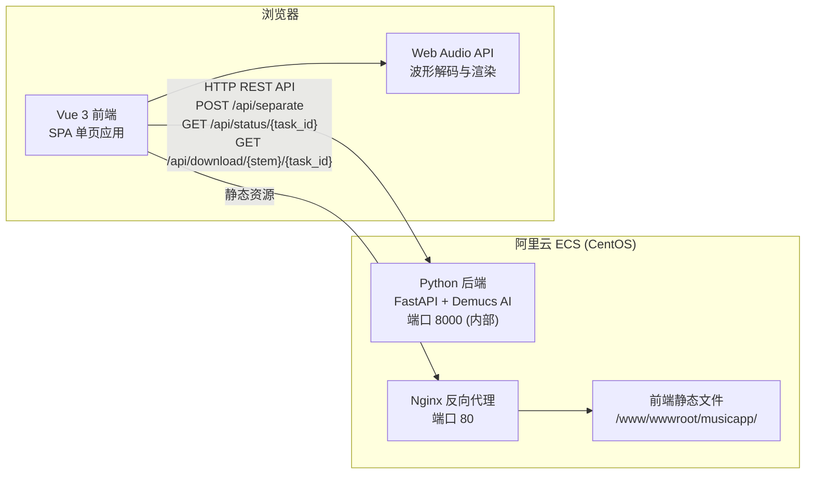
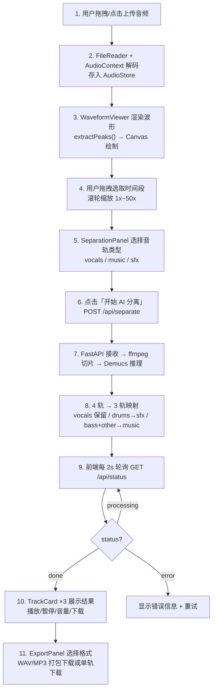
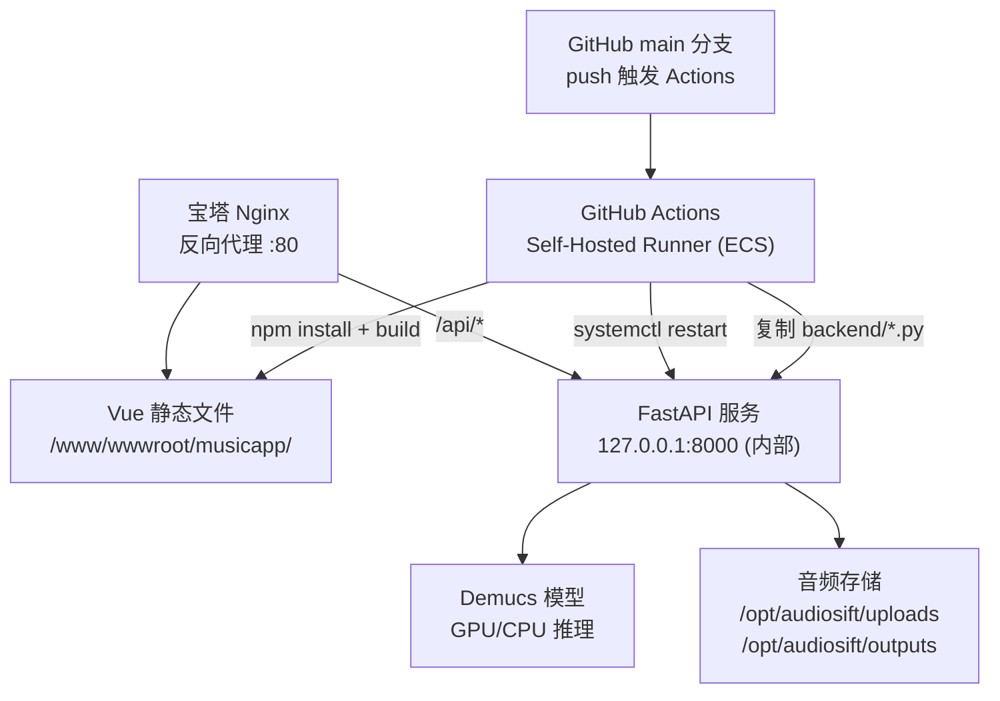

## 1. 架构设计



**核心架构说明**：
- AI 音轨分离在 **服务端** 运行（Demucs 模型部署在 ECS 上），非浏览器端推理
- 前端 Vue 3 SPA 通过 Nginx 提供静态文件服务，API 请求通过 Vite 开发代理或 Nginx `/api/*` 反代转发到 FastAPI
- 用户上传音频 → 后端 Demucs 分离 → 前端轮询状态 → 下载结果

## 2. 技术选型

| 层级 | 技术 | 说明 |
|-----|------|------|
| 前端框架 | Vue 3 + TypeScript | Composition API (`<script setup>`)，类型安全 |
| 构建工具 | Vite 5 | 极速 HMR，生产构建关闭 sourcemap |
| 样式方案 | TailwindCSS 3 | 原子化 CSS，dark mode class 策略 |
| 状态管理 | Vue `reactive`(composable 工厂模式) | 轻量全局状态，无需 Pinia |
| 路由 | Vue Router 4 (History 模式) | 4 个路由，全部懒加载 |
| 图标 | lucide-vue-next | 高质量 SVG 图标库 |
| HTTP 客户端 | 原生 fetch + FormData | 文件上传与 API 调用 |
| Canvas | 原生 Canvas 2D API | 波形图、粒子系统、鼠标遮罩轨迹 |
| 音频 | Web Audio API (AudioContext) | 浏览器端音频解码 |
| 后端框架 | FastAPI (Python) | 异步高性能 Web 框架 |
| AI 模型 | Demucs (Meta) `htdemucs` | 6 层混合 Transformer，最先进的音频源分离 |
| 波形计算 | 自定义峰值提取算法 | `extractPeaks()` 从 AudioBuffer 每个通道取最大绝对值按像素聚合 |
| 部署 | 阿里云 ECS + Nginx + systemd + 宝塔面板 | CentOS，GitHub Actions 自托管 Runner 自动部署 |

## 3. 路由定义

| 路径 | 路由名 | 页面组件 | 功能 |
|------|--------|----------|------|
| `/` | `workbench` | `HomePage.vue` | 主工作台：音频上传、波形分析、AI 分离、音轨预览、导出下载 |
| `/discover` | `discover` | `DiscoverPage.vue` | 音乐发现页：Banner 横幅、热歌排行、新歌速递、精选歌单、全局搜索浏览、底部播放器 |
| `/discover/playlist/:id` | `playlist` | `PlaylistPage.vue` | 歌单详情页：按 ID 展示歌单封面、描述、歌曲列表、底部播放器 |
| `/about` | `about` | `AboutPage.vue` | 品牌展示页：多层 Canvas 动画、鼠标视差互动、粒子系统、功能卡片 |

## 4. 前端组件树

```
App.vue (根布局容器)
├── AlbumWall.vue (全局背景：9×7 专辑封面无限循环滚动 + 毛玻璃遮罩)
│   └── backdrop-blur-[6px] 全局模糊层
├── AppSidebar.vue (固定侧边导航栏，240px 宽，z-40)
│   ├── Logo 区域（渐变图标 + "AudioSift"）
│   ├── Workbench 导航（Sparkles 图标）
│   ├── Discover 导航（Compass 图标）
│   ├── About 导航（UserRound 图标）
│   └── 底部用户区域（"Guest" + "Free Plan" + 头像）
└── <router-view /> (主内容区，ml-[240px]，z-10)
    │
    ├── [/] HomePage.vue (工作台)
    │   ├── Hero 标题区（标签 + 标题 + 功能说明图标）
    │   ├── UploadZone.vue (拖拽/点击上传，解码音频)
    │   ├── WaveformViewer.vue (Canvas 波形图，拖拽选区，滚轮缩放)
    │   ├── SeparationPanel.vue (音轨选择按钮组 + 开始分离 + 进度条)
    │   ├── TrackCard.vue ×3 (音轨预览卡片：播放/暂停/音量/下载)
    │   └── ExportPanel.vue (格式切换 WAV/MP3 + 打包下载/单轨下载)
    │
    ├── [/discover] DiscoverPage.vue (音乐发现)
    │   ├── 专属背景遮罩（backdrop-blur-[12px] bg-black/30，z-[2]）
    │   ├── Banner 横幅区（3 个渐变色卡片，粉/蓝/紫，hover 缩放）
    │   ├── Trending Now 热歌区（横向滚动卡片，封面 hover 放大 + 播放图标）
    │   ├── New Releases 新歌区（纵向列表，序号+封面+信息+时长）
    │   ├── Featured Playlists 精选歌单区（6 列 Grid，hover 蒙层+图标）
    │   ├── Browse All 浏览区（搜索框 + 流派筛选 + 可滚动列表 + 空状态）
    │   └── 底部播放器（Teleport to body，fixed bottom，player-slide 动画）
    │
    ├── [/discover/playlist/:id] PlaylistPage.vue (歌单详情)
    │   ├── 头部区（返回按钮 + 200×200 封面 + 歌单名 + 描述 + 统计）
    │   ├── 歌曲列表（行式布局，点击模拟播放）
    │   └── 底部播放器（与 Discover 共用 player-slide 动画）
    │
    └── [/about] AboutPage.vue (品牌展示)
        ├── Canvas 背景层（专辑封面，4 秒淡入淡出轮换，鼠标视差微移）
        ├── Canvas 粒子系统（60 个白色漂浮粒子，requestAnimationFrame 驱动）
        ├── Canvas 鼠标遮罩轨迹（destination-out 合成模式擦除，8 个拖尾点）
        ├── 内容层（大标题 "AudioSift"，技术标签毛玻璃药丸，鼠标反向微移）
        ├── 功能卡片 ×3（Vocal/Instrumental/Drum，独立滚动视差位移）
        └── 底部版权声明
```

## 5. 数据层

### 5.1 状态管理 (useAudioStore)

**文件**: `src/composables/useAudioStore.ts`

使用 Vue 3 `reactive` 实现全局共享状态（工厂函数模式，非 Pinia），通过 `useAudioStore()` 暴露。

| 字段 | 类型 | 默认值 | 说明 |
|------|------|--------|------|
| `audioFile` | `File \| null` | `null` | 用户上传的原始文件 |
| `audioBuffer` | `AudioBuffer \| null` | `null` | 解码后的 Web Audio API 缓冲区 |
| `audioDuration` | `number` | `0` | 音频总时长（秒） |
| `audioSampleRate` | `number` | `44100` | 采样率 |
| `timeSelections` | `TimeSelection[]` | `[]` | 用户在波形图上选取的时间段 |
| `activeStems` | `StemType[]` | `['vocals','music','sfx']` | 当前选中要分离的音轨类型 |
| `separationStatus` | `SeparationStatus` | `'idle'` | 分离任务状态（idle/uploading/processing/done/error） |
| `separationProgress` | `number` | `0` | 分离进度百分比（0-100） |
| `separationError` | `string \| null` | `null` | 分离错误信息 |
| `taskId` | `string \| null` | `null` | 后端任务 UUID |
| `results` | `Record<string, StemInfo>` | `{}` | 分离结果（vocals/music/sfx → {url, duration}） |
| `exportFormat` | `'wav' \| 'mp3'` | `'wav'` | 导出格式 |
| `playingTrack` | `StemType \| null` | `null` | 当前正在播放的音轨 |
| `soloTrack` | `StemType \| null` | `null` | Solo 独奏模式下的音轨 |
| `volumes` | `Record<StemType, number>` | 全 0.8 | 各音轨音量（0-1） |

暴露的方法：`setAudioFile`, `setAudioBuffer`, `setAudioInfo`, `addTimeSelection`, `removeTimeSelection`, `clearTimeSelections`, `toggleStem`, `setSeparationStatus`, `setSeparationProgress`, `setSeparationError`, `setTaskId`, `setResults`, `setExportFormat`, `setPlayingTrack`, `setSoloTrack`, `setVolume`, `reset`

### 5.2 工具函数 (useAudioUtils)

**文件**: `src/composables/useAudioUtils.ts`

| 函数 | 功能 |
|------|------|
| `decodeAudioFile(file)` | FileReader + AudioContext.decodeAudioData 解码音频为 AudioBuffer |
| `extractPeaks(buffer, targetWidth, startTime, endTime)` | 提取波形峰值 Float32Array，按像素聚合取最大绝对值 |
| `formatTime(seconds)` | 格式化为 `MM:SS.ms` |
| `generateUUID()` | crypto.randomUUID() 生成 UUID |
| `uploadAndSeparate(file, startTime, endTime, activeStems)` | POST /api/separate，FormData 提交 |
| `pollStatus(taskId)` | GET /api/status/{taskId}，每 2 秒轮询 |
| `getDownloadUrl(stem, taskId, format)` | 构造下载 URL |

### 5.3 模拟数据

**文件**: `src/data/songs.ts` — 30 首模拟歌曲数据（Song 接口：id, title, artist, album, duration, coverIndex, genre, year），8 种流派（Electronic, Pop, Hip-Hop, Rock, R&B, Classical, Jazz, Folk）

**文件**: `src/data/playlists.ts` — 12 个精选歌单（Playlist 接口：id, name, description, coverIndex, songIds[], tag），含 `getPlaylistSongs`, `getNewSongs`, `getTopSongs` 工具函数

### 5.4 音轨颜色常量

| Stem | 背景色 | 边框色 | 辉光色 | 中文标签 |
|------|--------|--------|--------|----------|
| vocals | `rgba(79,143,255,0.15)` | `#4f8fff` (蓝) | `rgba(79,143,255,0.3)` | 人声 |
| music | `rgba(180,100,255,0.15)` | `#b464ff` (紫) | `rgba(180,100,255,0.3)` | 配乐 |
| sfx | `rgba(255,140,60,0.15)` | `#ff8c3c` (橙) | `rgba(255,140,60,0.3)` | 音效 |

## 6. 全局样式体系

**文件**: `src/style.css`

| 层级 | 内容 |
|------|------|
| Base | 全局 reset（margin/padding 归零, box-sizing: border-box）；body 背景 `#08080c`，文字 `#e4e4ec`，系统字体栈；自定义 6px 滚动条（`#1a1a25` 深色滑条） |
| Components | `.glass-card`：毛玻璃卡片（渐变半透明白 + `backdrop-filter: blur(24px)` + 16px 圆角 + 1px 边框）；`.glow-button`：相对定位 + `overflow: hidden` 用于内部发光；`.range-slider`：自定义 range 输入（4px 高，粉色滑块 `#e04090` 带阴影） |
| Utilities | `.scrollbar-hide`：隐藏滚动条（兼容 Firefox + WebKit） |
| Animations | `shimmer`：左右扫描光效（粉色渐变，200% 宽，2s 无限循环）；`fade-in-up`：从 opacity 0 + translateY(12px) 淡入上浮，0.6s ease-out |

## 7. 后端 API 定义

### 7.1 POST /api/separate

上传音频文件并启动 AI 分离。

**请求**: `multipart/form-data`
| 字段 | 类型 | 说明 |
|------|------|------|
| file | File | 音频文件 (MP3/WAV/FLAC/OGG/M4A/AAC) |
| start_time | float | 起始时间(秒)，默认 0 |
| end_time | float | 结束时间(秒)，默认 -1 表示全文 |
| stems | string | 逗号分隔: "vocals,music,sfx" |

**响应**: `application/json`
```json
{
  "task_id": "uuid",
  "status": "processing",
  "message": "音频已接收，正在处理中"
}
```

### 7.2 GET /api/status/{task_id}

查询分离任务状态（前端每 2 秒轮询）。

**响应**:
```json
{
  "task_id": "uuid",
  "status": "done",
  "progress": 100,
  "stems": {
    "vocals": {"url": "/api/download/vocals/uuid", "duration": 30.5},
    "music": {"url": "/api/download/music/uuid", "duration": 30.5},
    "sfx": {"url": "/api/download/sfx/uuid", "duration": 30.5}
  }
}
```

### 7.3 GET /api/download/{stem}/{task_id}

下载分离后的音轨文件。

**查询参数**: `?format=wav` 或 `?format=mp3`

### 7.4 GET /api/health

健康检查，返回 GPU 可用性状态。

## 8. 完整数据流



## 9. AI 模型方案

采用 **Meta Demucs (htdemucs)** 模型：

- **模型**: htdemucs (Hybrid Transformer Demucs)，6 层混合 Transformer 架构
- **后端文件**: `backend/main.py`（FastAPI 入口）、`backend/separator.py`（分离器工具）
- **输入**: 44.1kHz 立体声音频
- **输出**: 4 轨原始分离 (vocals, drums, bass, other)
- **映射策略**:
  - `vocals` → 人声轨
  - `bass + other` → 配乐轨 (music)
  - `drums` → 音效轨 (sfx)
- **性能**: GPU (NVIDIA T4/A10) 上约 10x 实时；CPU 上约 0.5x 实时
- **依赖**: Python 虚拟环境 `.venv`，PyTorch 2.13 + torchaudio，通过 `separator.py` 的 `get_model()` 异步加载并缓存模型

## 10. 部署架构 (阿里云 + 宝塔面板)



- **操作系统**: CentOS（阿里云 ECS）
- **面板**: 宝塔面板管理网站和 Nginx
- **Python**: 3.10+（虚拟环境 `backend/venv/`）
- **GPU**: 可选，推荐 NVIDIA T4/A10（CPU 也能运行，但约慢 20 倍）
- **进程管理**: systemd (`audiosift.service`，以 root 运行，working directory `/opt/audiosift/backend`)
- **自动部署**: GitHub Actions → self-hosted runner → 前端部署到 `/www/wwwroot/musicapp/` → 重启后端服务
- **健康检查**: `GET /api/health` 返回 `{"status": "ok", "gpu_available": true/false}`

## 11. AlbumWall 背景滚动机制

`AlbumWall.vue` 是全应用共享的动态背景组件，在 `App.vue` 最底层渲染。

| 参数 | 值 |
|------|------|
| 网格尺寸 | 9 列 × 7 行 = 63 张专辑封面 |
| 卡片尺寸 | 200px × 200px |
| 卡片间距 | 24px |
| 网格总尺寸 | 120vw × 120vh（偏移 -10%） |
| 滚动方向 | 对角线（右下方向） |
| 滚动速度 | speed=0.55（水平 0.275px/帧，垂直 0.1925px/帧） |
| 循环方式 | offset 到达步长 224px 时回绕，多余行列作为缓冲区消除空隙 |
| 模糊遮罩 | `backdrop-blur-[6px]` 固定覆盖层（z-[1]） |
| 图片来源 | `/public/albums/album-1.jpg` ~ `album-30.jpg`，`(index-1) % 30 + 1` 循环使用 |
| 动画引擎 | `requestAnimationFrame` 驱动 |
| 性能 | `pointer-events-none` 不拦截鼠标事件 |

## 12. 页面特有的背景差异

| 页面 | 背景层 | 模糊程度 |
|------|--------|----------|
| Workbench (/) | AlbumWall 全局 `backdrop-blur-[6px]` | 轻度朦胧 |
| Discover (/discover) | AlbumWall `[6px]` + 页面自有 `backdrop-blur-[12px] bg-black/30`（ml-[240px]） | 较强磨砂 |
| Playlist (/discover/playlist/:id) | AlbumWall 全局 `backdrop-blur-[6px]` | 轻度朦胧 |
| About (/about) | 独立背景系统（Canvas 粒子 + 封面轮换 + 鼠标遮罩轨迹），不使用 AlbumWall | 自主控制 |
